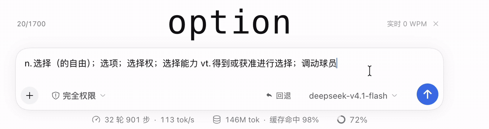

# Paocaiyu · 泡菜鱼

[](https://www.npmjs.com/package/@lnuxe/paocaiyu)
[](./LICENSE)
[](https://github.com/lnuxe/dsh-paocaiyu/actions/workflows/verify.yml)

[中文](./README.md) · English

A DSH plugin. A word shows up above your composer — you type it out. That's the whole thing.



## Install

```bash
pnpm --dir ~/.dsh/profiles/web add @lnuxe/paocaiyu
```

Refresh the page and the icon appears at the top-left of the sidebar. Not into npm? This works too:

```bash
pnpm --dir ~/.dsh/profiles/web add github:lnuxe/dsh-paocaiyu
```

## Use

Click the sidebar icon, or press `Tab` while the composer is empty. A word pops up above it with its phonetics; the composer shows the Chinese meaning as a hint.

Now just type it. Correct letters turn green, finishing the word moves you on. Get one wrong and it goes red, shakes, clears, and you start that word over.

`Esc` puts it away. Come back later and you pick up on the same word.

Want dictation instead — only the meaning, recall the spelling — switch "默写形态" in settings to hide letters: all, vowels only, consonants only, or random.

| Key | Does |
| --- | --- |
| `⌘←` / `Ctrl←` | previous word |
| `⌘→` / `Ctrl→` | skip |
| `⌘J` / `CtrlJ` | repeat this word |
| `⌘P` / `CtrlP` | pause / resume |
| `Esc` | close |
| `?` | forgot the keys? press this |
| `⌘/Ctrl+Alt+Q` | panic stop, works from any state |

No keyboard person? There's a button on each side of the word: "previous / restart" and "next / close".

## Dictionaries

371 dictionaries, ~410k words — CET-4/6, grad school, TOEFL, IELTS, business, code, Japanese. Only the one you pick gets downloaded, and 7 small ones ship inside so offline still works.

Bring your own list: "＋ 导入" at the bottom of the dictionary list. Paste `word 中文`, one per line, or feed it txt / csv / json.

## Progress

All of it lives in your browser. Nothing gets uploaded.

20 words make a chapter. Finish one and you get a summary: speed, accuracy, time, which words you missed — retry it or move on.

Missed words collect themselves into a mistake list you can drill on its own. Stats give you a 14-day bar chart, a 12-week heatmap, and the letter you fumble most.

Miss the same word 3, 4, 5 times and the hints escalate: first letter, then the answer.

## Settings

`Settings → 跟打`. Besides the dictation mode above: case sensitivity, ignore punctuation, show meaning, show phonetics, pronunciation, accent, key sounds, auto-advance chapters, read the definition, finger guide — plus backup export/import and a reset.

## One nice thing

Enter never sends. What you type never touches the draft. So you can practise inside any conversation without leaving a trace in the chat.

## Develop

```bash
npm run verify             # syntax + 1525 tests + smoke + size gate
npm test                   # tests only, no browser needed
npm run prepublish-check   # 40 pre-release checks
```

Two files do the work: `client.js` (everything, single file, no build step) and `test-client-logic.mjs`.

`client.js` has a hard ceiling of 480,000 bytes (currently 452,145 — 94.2%).

## Thanks

None of this exists without them:

- [Qwerty Learner](https://github.com/RealKai42/qwerty-learner) — where the "type-along" idea comes from, and **all 371 dictionaries with phonetics and Chinese meanings come from it** (GPL-3.0)
- [DSH / DeepSeek Harness](https://github.com/deepseek-ai/deepseek-harness) — the host: slots, composer, theme tokens, plugin runtime
- [React](https://react.dev) — the whole UI is hand-written `createElement`, MIT
- [Iconify](https://iconify.design) sets (tabler / heroicons / ic / bxs) — every SVG in the bar and the panel
- [jsDelivr](https://www.jsdelivr.com) and raw.githubusercontent — they deliver dictionaries to your browser on demand

How the dictionary data derives is spelled out in [NOTICE](./NOTICE); changes live in [CHANGELOG.md](./CHANGELOG.md).

## License

[GPL-3.0-only](./LICENSE) © 2026 lnuxe. It ships dictionary data derived from Qwerty Learner, so the whole project follows GPL-3.0.