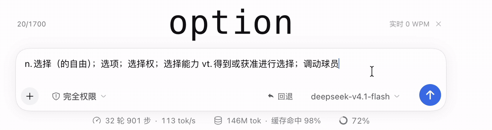

# 泡菜鱼 · Paocaiyu

> DSH 插件：在对话输入框里练英文打字。**输入框上方给一个英文单词，你照着它打一遍**——就是「跟打」。

- 包名：`@lnuxe/paocaiyu` · 命令：`/qwerty-autotype` · 许可证：GPL-3.0
- 词库：371 本 / 41 万词（四六级、考研、托福、雅思、商务、代码、日语……）



## 怎么用

1. 点侧栏左上角的图标，或者在输入框为空时按 `Tab`
2. 输入框上方出现一个英文单词（下面带音标），输入框里显示它的中文意思当提示；
   单词左右各贴着两颗按钮——左边「上一个 / 重开」、右边「下一个 / 关闭」，不用记快捷键
3. 你在输入框里把上面那个单词**照着打一遍**——打对的字母变绿，整词打完自动跳下一个
4. 打错就变红、抖动、清空，这个词从头重打
5. `Esc` 收起。关了再打开，接着上次那个词，不会从头来

想练**默写**（只给中文，凭记忆写英文），去设置里把「默写形态」改成隐藏字母：隐藏全部、只藏元音、只藏辅音、随机藏。

对话里练习时，输入框里只有那句中文提示，你敲的字不会留在草稿里，所以回车发不出消息，也不会进聊天记录。

## 快捷键

| 键 | 作用 |
| --- | --- |
| `⌘←` / `Ctrl←` | 上一个词 |
| `⌘→` / `Ctrl→` | 跳过这个词 |
| `⌘J` / `CtrlJ` | 循环当前词 |
| `⌘P` / `CtrlP` | 暂停 / 继续 |
| `Esc` | 收起 |
| `?` | 看快捷键提示 |

单词条两侧的按钮和上面这些键是一套动作，鼠标点也行：左边 `上一个 / 重开`，右边 `下一个 / 关闭`。

## 词库

- 内置 **371 本词库、41 万词**（四六级、考研、托福、雅思、商务、代码、日语……），选哪本才下哪本
- 断网也能用：自带 7 本小词库兜底
- 想用自己的词表：词库列表底部「＋ 导入」，粘贴 `word 中文` 一行一个，或者导入 txt / csv / json

## 练习记录

- 每打一个词、每打完一章都会记下来，全部存在浏览器本地，不传服务器
- **章**：20 个词一章。打完出结算页：速度、正确率、耗时、这一章打错的词，可重练或直接下一章
- **错词本**：错过的词自动收集，可以单独重练
- **统计**：近 14 天柱状图、12 周热力图、哪个字母最容易打错
- 同一个词错 3、4、5 次，会依次给提示（先给首字母，最后直接给答案）

## 设置

`设置 → 跟打`：默写形态（默认显示字母=跟打，改成隐藏字母=默写）、区分大小写、忽略标点、显示中文、显示音标、发音、口音、按键音、自动下一章、读释义、指法键盘，还能导出/导入备份、清空记录。

## 开发

```bash
npm run verify   # 语法检查 + 全部测试
npm test         # 只跑测试
npm run index    # 重新生成词库目录（371 本）
```

主要就是两个文件：`client.js`（全部功能）和 `test-client-logic.mjs`（测试）。测试不需要浏览器，用桩把组件真的渲染一遍。

## 安装

在 DSH 里以插件（bundle）方式装上就能用，不额外起服务：

```bash
# 从插件市场（npm）装
pnpm --dir ~/.dsh/profiles/web add @lnuxe/paocaiyu
# 或者直接从仓库装（不经过 registry）
pnpm --dir ~/.dsh/profiles/web add github:lnuxe/dsh-paocaiyu
```

装好后：侧栏左上角出现图标，输入框为空时按 `Tab` 也能起条。

## 说明

- 名字：**泡菜鱼（Paocaiyu）**—— 一个在输入框里陪你敲单词的小东西；功能上就是 qwerty-learner 的「跟打」
- 许可证 **GPL-3.0**，词库数据来自同样开源的 [qwerty-learner](https://github.com/Kaiyiwing/qwerty-learner)（见 [NOTICE](./NOTICE)）
- 改动记录见 [CHANGELOG.md](./CHANGELOG.md)
- 发布到插件市场的步骤见 [docs/publish-checklist.md](./docs/publish-checklist.md)
- 仓库：[lnuxe/dsh-paocaiyu](https://github.com/lnuxe/dsh-paocaiyu)（GitHub 仓库名只收 ASCII，中文名「泡菜鱼插件」放在标题与描述里）