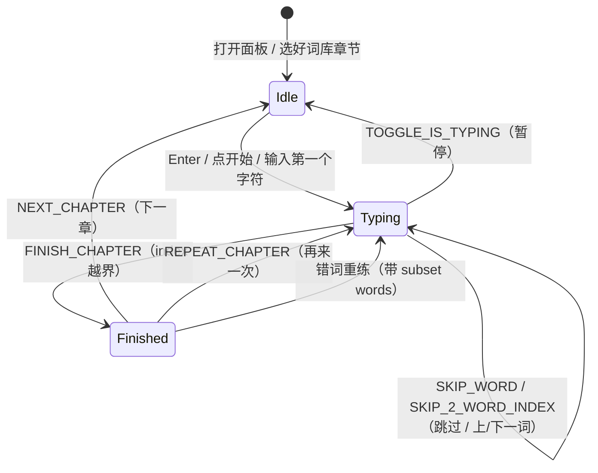
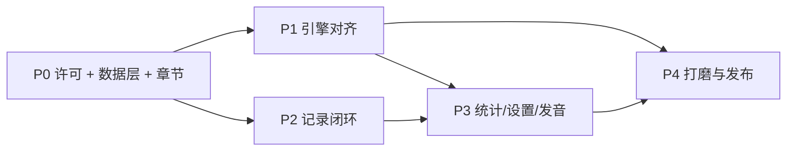

# qwerty-learner 能力迁移：需求与开发文档

> 目标：把 qwerty-learner 的**全量词库**与**练习模块能力**迁移进 DSH Web 插件 `@local/qwerty-autotype-ui`。
> 状态：规划稿（v1），实现前需先过 §6.1 的许可决策闸门。
> 版本：2026-11-24 · 对应插件 `v0.1.0`

## 摘要

| 项 | 值 |
| --- | --- |
| 迁移对象 | qwerty-learner（GPL-3.0）→ DSH 插件 `@local/qwerty-autotype-ui` |
| 词库规模差距 | 现状 7 库 / 560 词 → 目标 **371 库 / 414,469 词 / 74MB** |
| 需求条目 | **97 条**（DICT 17 / ENGINE 30 / DATA 25 / UI 25） |
| 阶段 | P0 地基 → P1 引擎 → P2 记录 → P3 统计设置 → P4 打磨，合计 **20–28 人日** |
| 硬决策 | ① 许可改为 GPL-3.0（§6.1）；② 词库运行时按需拉 + IndexedDB 缓存（§2.1）；③ 不做云同步（§4.5） |
| 最大风险 | 许可冲突、74MB 数据加载、真实 composer 拦截与宿主快捷键冲突 |
| **实施进度** | P0 **7/7**、P1 **6/6**、P2 **5/5**、P3 **4/4**、P4 **2/2**、追加 **4 项**（自定义词表 / 键盘热力图 / 缓存管理 / 词表文件导入导出），自动化测试 **456 条全绿** |

## 目录

- [摘要](#摘要)
- [1. 背景、目标与现状盘点](#1-背景目标与现状盘点)
- [2. 词库数据层（DICT）](#2-词库数据层dict)
- [3. 练习引擎与交互（ENGINE）](#3-练习引擎与交互engine)
- [4. 记录、错词本与统计（DATA）](#4-记录错词本与统计data)
- [5. DSH 集成与界面规划（UI）](#5-dsh-集成与界面规划ui)
- [6. 里程碑、任务拆分与排期](#6-里程碑任务拆分与排期)
- [7. 测试与验收策略](#7-测试与验收策略)
- [8. 风险登记簿](#8-风险登记簿)

## 1. 背景、目标与现状盘点

### 1.1 文档目的

本文档定义「把 qwerty-learner 的单词与模块能力迁移进 DSH Web 插件」的**需求与开发计划**。读者是实现者与评审者：读完应能独立判断"某个上游功能要不要做、做成什么样、怎么验收"。

范围：`@local/qwerty-autotype-ui`（Client 半边）+ `@local/qwerty-autotype`（Host 半边，只提供 `/qwerty-autotype` 指令与三个 driver 工具，本次不在迁移范围内）。
不在范围：DSH 宿主本身的修改、任何服务端/账号体系、上游站点的运营功能（Gallery、FriendLinks、Donate、Share 出图）。

### 1.2 两个系统各是什么

| | 上游 qwerty-learner | 目标插件 qwerty-autotype-ui |
| --- | --- | --- |
| 形态 | 独立 React 18 SPA（Vite + jotai + Tailwind/headlessui + Dexie） | DSH Web 的 Cordis 插件，纯前端 `client.js`，只能用 `h()` 渲染，注册到宿主插槽 |
| 数据 | 371 个词库 / 414,469 词 / `public/dicts` 共 74MB，运行时按词库拉 JSON | 7 个词库 / 560 词，**内联**进 `client.js`（当前 93,789 字节 / 1,009 行） |
| 输入 | 自带隐藏 `<textarea>` + 全局键盘监听 | 复用宿主**真实 composer**（`[data-composer-input]`，Lexical contenteditable），捕获阶段拦截 keydown；面板内另有一个真 `<input>` |
| 记录 | IndexedDB（`src/utils/db/`），错词本 + 统计页 | 只有 `localStorage['qwerty-autotype:dict']`，无任何练习记录 |
| 界面 | 独立站点（Typing / Analysis / ErrorBook / WordList / Mobile …） | 4 个插槽：`sidebar.panellist`、`main`、`conversation.input.dock`、`conversation.chat.commandview` |
| 许可 | **GPL-3.0**（`LICENSE` 第 1 行 `GNU GENERAL PUBLIC LICENSE Version 3`） | MIT |

> ⚠️ **许可约束（P0 级，必须先决策）**：上游是 GPL-3.0，而本插件当前是 MIT 且已把上游词库数据（560 词）内联进 `client.js`。全量迁移会把"数据 + 结构 + 交互"一起搬过来，继续标 MIT 站不住。三条出路见 §6.1，**必须在 P0 阶段定下来**，否则后面每一步都在放大风险。

### 1.3 插件现状（迁移起点）

已完成并已推送 GitHub（`lnuxe/qwerty-autotype-ui`，tag `v0.1.0`）：

| 能力 | 实现 |
| --- | --- |
| 侧栏左上角入口 | `sidebar.panellist` id `qwerty-autotype` order 5，与「插件」同一排；点击由外壳执行 `layout.selectPanel('qwerty-autotype')` |
| 面板 | `main` key `qwerty-autotype`：词库下拉（分类 optgroup）+ 56px 大字 + 音标 + 中文 + 自带输入框的卡片 |
| 对话内跟打条 | `conversation.input.dock` order 10：34px 单词 + 音标，宽度按 composer 正文实测中线对齐 |
| 指令入口 | `conversation.chat.commandview` key `qwerty-autotype`，`/qwerty-autotype [自定义词…]` |
| 判定 | `judgeTyping` / `pushChar`：逐字母，打对变绿、打错变红 + 抖动 + 清空 + **整词重打**、整词打对进下一词、超长忽略 |
| 中文释义 | 写进 composer 草稿 → 显示在输入框里；收起时撤回 |
| 安全边界 | 练习期间吞掉输入框区域的 Enter / Tab / `Cmd+Enter` 与那一排按钮的点击，草稿发不出去 |
| 快捷键 | <kbd>Tab</kbd>（输入框为空时）快速启动对话内跟打条 |
| 测试 | 45 条：判定 / `pushChar` / 词库 / 渲染冒烟（一次性 React 桩真的调一遍组件） |

### 1.4 差距清单（迁移要补的洞）

| 维度 | 上游 | 插件 | 差距 |
| --- | --- | --- | --- |
| 词库规模 | 371 库 / 414,469 词 / 10 个分类 / 6 种语言 | 7 库 / 560 词 | **~750×** 词量差距，必须换成运行时按需加载 |
| 章节 | `CHAPTER_LENGTH` + `calcChapterCount`，按章练习、记进度 | 无 | 无章节概念，一轮随机 20 词 |
| 练习模式 | 拼写 + 默写（全部隐藏 / 隐藏元音 / 隐藏辅音 / 随机隐藏） | 仅拼写 | 少 4 种默写形态 |
| 循环与跳转 | 单曲循环、跳过、上一词/下一词、重复本章、下一章 | 仅"重开" | 少 6 类导航动作 |
| 指标 | 实时 WPM、正确率、用时、逐词计时 | 仅 命中/重打 计数 | 缺速度与准确率 |
| 记录 | 单词记录、字母级错误、复习记录、错词本 | 无 | 全缺 |
| 统计 | 每日练习量、趋势、热力图 | 无 | 全缺 |
| 设置 | View / Advanced / Sound / Data 四组 | 仅词库选择 | 全缺 |
| 发音与音效 | 单词朗读、键音、音量 | 无 | 全缺 |
| 快捷键 | 十余个热键 | 1 个（Tab） | 少约 10 个 |
| 结果页 | 结算页（准确率/WPM/错词/结论） | 一行"完成" | 缺 |
| 词库导航 | 分类 → 词库 → 章节三级 + 搜索 | 一个扁平下拉 | 信息架构不够用 |

### 1.5 目标与非目标

**目标（P0–P3 内完成）**

1. 全量词库可用：371 个词库、41.4 万词，按需加载、可离线复用、切换不超过 1 次网络往返。
2. 练习引擎对齐上游：拼写 + 4 种默写、章节、循环/跳过/上下词、WPM 与正确率。
3. 记录闭环：单词级 + 字母级记录 → 错词本 → 针对性重练；章节进度可续。
4. 与 DSH 融为一体：面板为主入口，对话内跟打条为轻入口，Tab 启动，视觉全部走 `--dsw-alias-*` token，zh/en 双语齐。

**非目标（明确不做）**

| 不做 | 理由 |
| --- | --- |
| 账号、云同步、多端同步 | 插件无后端，DSH 也不提供；本地即真相 |
| 移动端专用页（上游 `pages/Mobile`） | DSH Web 桌面优先，先不做 |
| Gallery / FriendLinks / Donate / 分享出图 | 运营与社区功能，与"在对话里背单词"无关 |
| 复刻上游 Tailwind 视觉 | 必须服从宿主设计语言（token） |
| 浏览器扩展开关、桌面端 | 与本插件形态无关 |

### 1.6 术语

| 词 | 含义 |
| --- | --- |
| 词库（dict） | 一个 JSON 文件，含若干词条；上游 371 个（`dictionary.ts` 373 条记录，2 个 id 重复） |
| 章节（chapter） | 词库按固定长度切分的练习单元，进度以章节为单位保存 |
| 默写（dictation） | 隐藏部分字母的练习形态（`hideAll` / `hideVowel` / `hideConsonant` / `randomHide`） |
| 跟打条 | 对话里输入框正上方那条窄条（`conversation.input.dock`） |
| 面板 | 左侧栏图标切出来的整页（`main` key） |
| 插槽（slot） | DSH 的 UI 扩展点，插件往里面注册组件 |

### 1.7 硬约束（设计的边界条件）

| 约束 | 影响 |
| --- | --- |
| 纯前端、无后端、无账号 | 记录只能本地；导出/导入即唯一迁移通道 |
| `client.js` 单文件被宿主加载 | 全量词库**不能内联**（74MB）；代码体积要控制在数百 KB 内 |
| 只能用 `h()`，无 JSX、无构建期依赖注入 | 组件与样式都要手写；不能直接搬上游 `.tsx` |
| 插槽语义由宿主拥有 | `sidebar.panellist` 的点击 = 切中央面板，插件拿不到点击语义；`main` 面板是 root 作用域，**没有 sessionId** |
| 上游 GPL-3.0 | 见 §1.2 警示，先定许可再动工 |
| 宿主版本会变 | 插槽 API 只走文档化字段，不私有 hack |
## 2. 词库数据层（DICT）

当前插件把 7 个词库共 560 词内联在 `client.js` 里；上游是 **371 个词库 / 414,469 词 / 74MB** 的独立 JSON 文件。本章定义如何把这套数据搬到插件里而不把 `client.js` 撑爆。

**已核实的上游事实**

| 事实 | 值 | 证据 |
| --- | --- | --- |
| 词库数 | 371（去重后；原始 373 条含 2 个重复 id：`frequently_used_words03`、`Oxford5000`）（`id/name/description/category/tags/url/length/language/languageCategory`） | `src/resources/dictionary.ts` 全文 |
| 词条总数 | 414,469（`length` 字段求和，去重后），平均 1,131，最大 20,199 | 同文件 `length` 字段 |
| 文件总量 | 380 个 JSON / 74MB | `public/dicts/` |
| 单库体积 | 最大 `coca20000.json` 4.4MB，最小若干代码词库 4KB | `ls -S` |
| 词条结构 | 裸数组，`{ name, trans: string[], usphone, ukphone }` | `public/dicts/CET4_T.json`（2607 条） |
| 分类 | 青少年英语 156 / 国际考试 95 / 中国考试 51 / 代码练习 46 / 日语学习 18 / 德语学习 2 / 哈萨克语 2 / 英语词典 1 / 专业词汇 1 / 印尼语 1 | `dictionary.ts` 的 `category` |
| 语言 | `en` / `code` / `ja` / `de` / `kk` / `id`；`code` 与 `ja` 部分无音标 | `languageCategory` + `it-words.json` |
| 章节 | `CHAPTER_LENGTH = 20`，`calcChapterCount(len) = ceil(len / 20)` | `src/constants/index.ts:3`、`src/utils/index.ts:94-96` |

### 2.1 数据获取策略

| 候选 | 做法 | 体积影响 | 离线 | 结论 |
| --- | --- | --- | --- | --- |
| A 全量内联 | 把 74MB 塞进 `client.js` | 不可行 | ✅ | 否决 |
| B 随插件发子集 | 只打包常用 20 库 | 仍数 MB，且永远缺库 | ✅ | 仅作兜底 |
| **C 运行时按需拉 + 本地缓存** | 只内联**元数据索引**（371 条，**62.4KB**），词条 JSON 用时再拉 | 主包 +40KB | 二次访问 ✅ | **主线** |

选定 **C**：内置 `dicts.index.json`（371 条元数据）+ 现有 7 库 560 词作为离线兜底 → 点击某个词库/章节时才拉它的 JSON。

**REQ-DICT-01｜词库元数据索引内联，词条按需拉取**
优先级 **P0**
验收：断网启动插件，词库列表仍能列出 371 个词库（显示"离线，需联网加载"）；联网后点任一库能拉到词条。

**REQ-DICT-02｜拉取源按优先级回退**
优先级 **P0**
回退链：① jsDelivr `https://cdn.jsdelivr.net/gh/<owner>/<repo>@<pinned-ref>/public/dicts/<file>` ② `https://raw.githubusercontent.com/<owner>/<repo>/<ref>/public/dicts/<file>` ③ 本地开发 `http://127.0.0.1:8081/dicts/<file>`（仅 localhost 环境尝试）④ 内置兜底库。
`<ref>` 必须钉版本（tag 或 commit sha），禁止跟 `main` 浮动。
验收：把 ① 的域名在 hosts 里指向黑洞，仍能通过 ② 加载；三源全失败时给可读提示并回退兜底词库。

**REQ-DICT-03｜拉取带并发闸与超时**
优先级 **P1**
同一词库的并发请求合并为一个 Promise；单请求超时 10s；失败重试 1 次（指数退避 500ms）。
验收：快速连点同一词库 5 次，网络面板只有 1 个请求。

### 2.2 缓存层

**REQ-DICT-04｜IndexedDB 缓存归一化后的词条**
优先级 **P0**
- 库：`qwerty-autotype`，store `dicts`，key = `<dictId>@<ref>`，value = `{ dictId, ref, fetchedAt, words: [{w, ipa, zh}] }`。
- 另存 `meta` store 记录 `{ key, bytes, lastUsed }` 供容量统计与 LRU。
- 命中缓存时**不再发网络请求**（除非用户点"刷新词库"）。
验收：第二次切换同一词库，网络面板 0 请求，切换耗时 ≤ 50ms。

**REQ-DICT-05｜容量上限与 LRU 淘汰**
优先级 **P1**
软上限 40MB；超限时按 `lastUsed` 淘汰最久未用的词库（当前正在用的除外），并提示"已清理 N 个词库的离线缓存"。
验收：反复加载 20 个大词库后，`navigator.storage.estimate()` 占用 ≤ 45MB。

**REQ-DICT-06｜缓存版本与失效**
优先级 **P1**
缓存 key 含 `ref`；`ref` 变更即视为新条目（旧条目走 LRU 淘汰）。schema 变更时写一次 `schemaVersion` 迁移清空缓存。
验收：改 `ref` 后首次加载走网络，旧条目在容量压力下被淘汰。

### 2.3 数据归一化

**REQ-DICT-07｜词条模型统一为 `{ w, ipa, zh }`**
优先级 **P0**
映射规则：
1. `w = name.trim().toLowerCase()`（保留词内 `'`、`-`；含空格的非英文条目见 REQ-DICT-09）。
2. `ipa`：`ukphone` 优先，缺失取 `usphone`；多音变体以 `;` 分割取第一支；`'` → `ˈ`；首尾用 `/` 包裹；都缺失则为 `''`。
3. `zh`：`trans` 数组用 `；` 连接，压缩连续空格、去掉中文标点两侧空格。

验收：`CET4_T.json` 的 `cancel` 归一化后 `{"w":"cancel","ipa":"/ˈkænsl/","zh":"取消，撤销；删去"}`。

**REQ-DICT-08｜非法词条过滤**
优先级 **P0**
丢弃：`name` 为空、`trans` 为空、长度 > 40、纯数字、含不可打印字符。允许：字母、`'`、`-`、空格（词组）、带变音符的拉丁字母、假名/谚文（见 09）。
验收：加载后统计 `dropped` 数并打日志；任一库的 `dropped` 比例 > 5% 时警告。

**REQ-DICT-09｜非英文与代码词库的差异化处理**
优先级 **P1**
- `en`（306 库）：标准判定，逐字母 ASCII 比对。
- `code`（45 库）：无音标字段 → `ipa` 恒为 `''`，UI 不渲染音标行；判定**保留大小写**（`SQL_statement_upper-case` 这类库大小写有意义）。
- `ja` / `de` / `kk` / `id`（23 库）：允许非 ASCII 字符，判定按 Unicode 码点逐字符比对；`de` 的变音（ä/ö/ü/ß）需要明确"必须打变音"还是"允许 ae/oe/ue/ss"→ **默认必须打变音**，在词库信息里注明。
验收：任选一个日语库与一个代码库，能完整练完一章；代码库不出现空音标行。

**REQ-DICT-10｜归一化结果可复算**
优先级 **P2**
归一化产出一个纯函数 `normalizeWord(raw, languageCategory)`，无副作用；同一输入永远同一输出。
验收：单测覆盖 en / code / ja / de 四种情况各 ≥ 2 条。

### 2.4 章节模型

**REQ-DICT-11｜章节切分对齐上游**
优先级 **P0**
`CHAPTER_LENGTH = 20`；`chapterCount = ceil(words.length / 20)`；第 `ch` 章（0-based）的词区间为 `[ch*20, min((ch+1)*20, len))`。
验收：2607 词的 CET-4 → 131 章，最后一章 7 词。

**REQ-DICT-12｜章节进度存储 key**
优先级 **P1**（写入逻辑在 §4）
`qwerty-autotype:progress:<dictId>:<chapter>` → `{ index, correctCount, wrongCount, updatedAt }`；跨词库天然隔离。
验收：两个词库各自练到第 3 章，来回切换后各自续上。

**REQ-DICT-13｜"继续上次"定位**
优先级 **P1**
面板打开时若有未完成章节，直接在词库卡上标"继续第 N 章"；否则落到第 0 章。
验收：练到一半关面板再打开，落回同一章同一词位。

### 2.5 词库选择器信息架构

三级：**分类 → 词库 → 章节**。371 个词库用扁平下拉已不可用。

**REQ-DICT-14｜三级导航**
优先级 **P0**
- 一级：10 个分类（带词库数），顶部"最近使用"（最多 5 个）。
- 二级：该分类下词库列表，每行 `名称 · 词数 · 标签`，可搜索（按名称/id/tags）。
- 三级：章节网格（`1..N`），标注已完成/进行中/未开始。
验收：从面板默认页到"开始练 CET-4 第 3 章"不超过 3 次点击。

**REQ-DICT-15｜搜索**
优先级 **P1**
输入即筛（防抖 150ms），匹配 `name` / `id` / `tags` / `description`；结果扁平展示并标所属分类；支持键盘 ↑↓ + Enter。
验收：输入 `ielts` 能列出所有 IELTS 相关词库。

**REQ-DICT-16｜词库信息面**
优先级 **P2**
展示 `name / description / category / tags / length / 章数 / 语言`，以及数据来源与许可（呼应 §1.2）。
验收：任一词库详情页能看到"来自 qwerty-learner · GPL-3.0"字样。

### 2.6 接口契约（`DICT` 模块对外函数）

| 函数 | 入参 | 返回 | 同步性 | 缓存语义 |
| --- | --- | --- | --- | --- |
| `listDicts()` | — | `DictMeta[]`（371 条） | 同步 | 内联索引，永久 |
| `dictsByCategory()` | — | `{ category, dicts }[]` | 同步 | 基于 `listDicts` 的记忆化 |
| `searchDicts(q)` | `q: string` | `DictMeta[]` | 同步 | 无 |
| `loadDict(id)` | `id` | `Promise<Word[]>` | 异步 | 内存 → IndexedDB → 网络 → 兜底 |
| `chaptersOf(id)` | `id` | `{ count, length }` | 同步（需 `loadDict` 已完成） | 记忆化 |
| `wordsOfChapter(id, ch)` | `id, ch` | `Word[]`（≤20） | 同步（需已 load） | 记忆化 |
| `preload(id)` | `id` | `Promise<void>` | 异步 | 预热缓存，失败静默 |
| `refreshDict(id)` | `id` | `Promise<Word[]>` | 异步 | 绕过缓存强制重拉 |
| `cacheStats()` | — | `{ entries, bytes }` | 异步 | 读 IndexedDB |
| `normalizeWord(raw, lang)` | `raw, lang` | `Word \| null` | 同步纯函数 | 无 |

错误约定：网络类错误抛 `DictLoadError{ dictId, reason: 'network' \| 'notfound' \| 'parse' }`；调用方必须能区分"没网"与"库不存在"。

### 2.7 风险与未决

| # | 风险 | 处置 |
| --- | --- | --- |
| 1 | **许可**：上游 GPL-3.0，当前仓库 MIT 且已内联其数据 | 见 §6.1，P0 决策 |
| 2 | CDN 不可达 / 跨域 / 防盗链 | 三源回退 + 内置兜底；不依赖单一域名 |
| 3 | 单库 4.4MB，首开慢 | 章节化按需渲染 + 加载进度 + 缓存 |
| 4 | 多语言音标缺失、变音字符判定 | 差异化规则（REQ-DICT-09） |
| 5 | 上游词库更新 | 钉 `ref` + 季度同步任务 |
| 6 | 缓存占满浏览器配额 | LRU + `navigator.storage.estimate()` 兜底 |
| 7 | 隐私 | 只拉公共 JSON，不上报任何用户数据 |
## 3. 练习引擎与交互（ENGINE）

插件现在的判定只有三条：打对变绿、打错红+抖动+清空整词重打、整词打对进下一词。本章把这套规则扩展成上游的完整形态。

**已核实的上游事实**

| 事实 | 值 | 证据 |
| --- | --- | --- |
| 打错语义 | 「出错会清空整个输入，但只记录一次错误」——与插件现状一致 | `src/utils/db/record.ts:58-59` 注释 |
| 字母级错误 | `LetterMistakes: { [字母索引]: 打错的 e.key[] }` | `src/utils/db/record.ts:19-22` |
| 计时/指标 | `TICK_TIMER`：`time += 1`（可传 `addTime`）；`accuracy = round(correct / (correct + wrong) * 100)`；`wpm = round(wordCount / time * 60)` | `src/pages/Typing/store/index.ts:191-203` |
| 输入通道 | 隐藏 `<textarea>` 的 `onInput` 读 `nativeEvent.data`，**`isComposing` 时忽略**，读完清空 | `WordPanel/components/TextAreaHandler/index.tsx:25-35` |
| 默写形态 | `hideAll` / `hideVowel` / `hideConsonant` / `randomHide` | `WordDictationSwitcher/index.tsx:18-32` |
| 状态机 | 21 个 action（见 3.3） | `src/pages/Typing/store/index.ts:37-59` |

### 3.1 判定语义

**REQ-ENG-01｜逐字母比对，按索引定位第一个错位**
优先级 **P0**
`judgeTyping(word, input)` 返回 `ok | bad(index) | done | over`：与插件现有实现一致，逐字符比对，返回第一个不匹配的下标。

**REQ-ENG-02｜打错立即清空、整词重打，且只记 1 次错**
优先级 **P0**
打错 → 该字母标红 + 抖动 + 输入清空；`wrongCount += 1`（**不是每个错字母各加 1**）；同一次尝试内多次打错各计 1 次。
验收：一个词连续打错 3 次，`wrongCount` 为 3 而非错字母总数。

**REQ-ENG-03｜大小写策略按词库语言确定**
优先级 **P1**
`en` 词库：默认**不区分大小写**（输入 `Cancel` 也通过），可在设置里开"严格大小写"。
`code` 词库：**强制区分大小写**（`SQL_statement_upper-case` 这类库大小写有语义）。
验收：同一按键序列在 CET-4 与 SQL 库里结果不同。

**REQ-ENG-04｜非字母字符（空格、撇号、连字符、变音符号）**
优先级 **P1**
词组（如 `ice cream`）必须打空格；`don't` 必须打撇号；德语变音必须打 `ä/ö/ü/ß`（不做 `ae` 展开）。
验收：`ice cream` 少打空格判 `bad`；`icecream` 不通过。

**REQ-ENG-05｜退格与非法键**
优先级 **P1**
Backspace：**不允许删已判定正确的字母**（正确字母锁定），只允许在"打错前的当前字母"上无操作；上游是打错即清空，故退格主要影响"打错但还没清空前"的极短窗口——插件统一为：Backspace 不改变已正确字母，也不触发新判定。
验收：打对 3 个字母后按 Backspace，3 个绿字母仍在。

**REQ-ENG-06｜超长输入忽略**
优先级 **P0**
已与上游一致：达到词长后再输入不改变状态（`over`）。

**REQ-ENG-07｜首字母提示与 TipAlert**
优先级 **P1**
上游 `TipAlert` 在打错时给"正确字母是 X"一类提示（`Word/TipAlert.tsx`）。插件保留一个"打错后短暂显示该位置正确字母"的开关（默认开，300ms 后淡出）。

### 3.2 练习模式

**REQ-ENG-08｜拼写模式（默认）**
优先级 **P0**
单词完整可见，逐字母判定。

**REQ-ENG-09｜默写四形态**
优先级 **P1**
`hideAll`（整词隐藏，只留字母位数）/ `hideVowel`（隐藏元音）/ `hideConsonant`（隐藏辅音）/ `randomHide`（隐藏约半数随机字母）。被隐藏的字母**仍然必须打对**，只是不显示。
验收：四种形态各打完一个词，判定结果与拼写模式相同。

**REQ-ENG-10｜翻译显隐**
优先级 **P0**
`isTransVisible`：关掉后不显示中文（练习时不剧透）。状态持久化。

**REQ-ENG-11｜单词显隐（默写 peek）**
优先级 **P1**
按住 <kbd>Tab</kbd> 临时显示完整单词，松开恢复（上游 `Word/index.tsx:104-122`）。对话内跟打条里 Tab 已被"启动"占用 → 那条路径改为 <kbd>Ctrl</kbd> 按住 peek（见 3.6 冲突表）。

### 3.3 状态机



**REQ-ENG-12｜状态机覆盖上游 21 个 action**
优先级 **P0**
必须实现：`SETUP_CHAPTER` / `SET_IS_SKIP` / `SET_IS_TYPING` / `TOGGLE_IS_TYPING` / `REPORT_WRONG_WORD` / `REPORT_CORRECT_WORD` / `NEXT_WORD` / `LOOP_CURRENT_WORD` / `FINISH_CHAPTER` / `INCREASE_WRONG_WORD` / `SKIP_WORD` / `SKIP_2_WORD_INDEX` / `REPEAT_CHAPTER` / `NEXT_CHAPTER` / `TOGGLE_WORD_VISIBLE` / `TOGGLE_TRANS_VISIBLE` / `TICK_TIMER` / `ADD_WORD_RECORD_ID` / `SET_IS_SAVING_RECORD` / `SET_IS_LOOP_SINGLE_WORD` / `SET_REVISION_INDEX`。
不做：`SET_REVISION_INDEX` 的"复习模式"完整实现（见 §4 的错词重练替代）。

**REQ-ENG-13｜单曲循环**
优先级 **P1**
开 `isLoopSingleWord` 后，整词打对仍留在当前词，`命中 +1` 累加不推进；关闭后下次打对正常推进。

**REQ-ENG-14｜跳过与上下词**
优先级 **P1**
跳过当前词（不计对错，标记 `skipped`）；上一词/下一词直接移动 `index`，不判定。

**REQ-ENG-15｜章节完成判定**
优先级 **P0**
`index` 到达本章词数即 `FINISH_CHAPTER` → 结果页；`wordCount` 可能大于章节词数（循环导致），完成判定只看 `index`。

### 3.4 计时与指标

**REQ-ENG-16｜计时口径**
优先级 **P0**
`TICK_TIMER` 每 1s 递增；**只在 `isTyping` 为真时计时**；失焦 / 切走面板 / 暂停 → 停表；恢复后继续累计（不清零）。

**REQ-ENG-17｜正确率**
优先级 **P0**
`accuracy = round(correctCount / (correctCount + wrongCount) * 100)`，分母为 0 时按 1（上游同款）。
验收：打对 8 个、打错 2 次 → 80%。

**REQ-ENG-18｜WPM**
优先级 **P0**
`wpm = round(wordCount / time * 60)`，`time` 为秒；`time` 为 0 时显示 `—`。
验收：60s 内打对 20 词 → 20。

**REQ-ENG-19｜指标实时刷新**
优先级 **P1**
每秒刷新一次（随 `TICK_TIMER`），不做每键刷新，避免与逐字母渲染抢帧。

### 3.5 反馈

**REQ-ENG-20｜打对**：目标字母变绿 + 下划线（非纯颜色区分），无音效。
**REQ-ENG-21｜打错**：该字母变红 + 波浪下划线 + 卡片抖动 240ms + 输入清空 + 可选键音。
**REQ-ENG-22｜发音**：`Ctrl+J` 朗读当前词；引擎优先级 Web Speech (`speechSynthesis`, `lang=en-US`) → 不可用则隐藏入口并提示。代码词库不做朗读。
**REQ-ENG-23｜键音**：可开关 + 音量 0–100；默认关（对话场景下突然发声很吓人）。

### 3.6 键盘路径与快捷键

**REQ-ENG-24｜双通道输入**
优先级 **P0**
- 面板：自带真 `<input>`，直接读 `keydown`。
- 对话：复用真实 composer（`[data-composer-input]`），捕获阶段拦截；**`event.isComposing` 为真时一律不拦**（中文输入法安全），并在 `compositionend` 后清空一次输入。

**REQ-ENG-25｜快捷键表**

| 键位 | 作用 | 上游 | 插件落位 |
| --- | --- | --- | --- |
| <kbd>Enter</kbd> | 开始 / 暂停练习 | `StartButton/index.tsx:22` | 面板内生效；对话内**仍然吞掉**（不发送） |
| <kbd>Tab</kbd>（按住） | peek 翻译 / peek 单词 | `WordPanel/index.tsx:115-130`、`Word/index.tsx:104-122` | 面板内：按住 peek；对话内：<kbd>Tab</kbd> 为空输入框时的启动键（**冲突，见下**） |
| <kbd>Ctrl</kbd>+<kbd>J</kbd> | 朗读当前词 | `Word/index.tsx:121-128` | 保留 |
| <kbd>Ctrl</kbd>+<kbd>V</kbd> | 切换默写模式 | `WordDictationSwitcher/index.tsx:55-61` | 保留（注意与粘贴冲突：练习中拦截粘贴） |
| <kbd>Ctrl</kbd>+<kbd>Shift</kbd>+<kbd>V</kbd> | 翻译显隐 | `Switcher/index.tsx:34-41` | 保留 |
| <kbd>Ctrl</kbd>+<kbd>Shift</kbd>+<kbd>←</kbd> / <kbd>→</kbd> | 上一词 / 下一词 | `WordPanel/index.tsx:106-127` | 保留 |
| <kbd>Enter</kbd> | 结果页：下一章 | `ResultScreen/index.tsx:174-180` | 保留 |
| <kbd>Space</kbd> | 结果页：再来一次 | `ResultScreen/index.tsx:182-190` | 保留 |
| <kbd>Shift</kbd>+<kbd>Enter</kbd> | 结果页：默写重练 | `ResultScreen/index.tsx:192-198` | 保留 |
| <kbd>Esc</kbd> | 收起跟打条 / 退出练习 | 插件自定 | 保留 |

**冲突裁决（REQ-ENG-26，P0）**：对话内 <kbd>Tab</kbd> 有两个语义 —— "输入框为空时启动跟打条"（现有）与"按住 peek 单词"。规则：
1. 跟打条**未开启**且输入框为空 → Tab 启动；
2. 跟打条**已开启** → Tab 一律作为 peek（启动已无意义）；
3. 输入框非空 → Tab 还给宿主（切焦点）。

**REQ-ENG-27｜与宿主的边界**
优先级 **P0**
- 练习期间吞掉：`Enter` / `Shift+Enter` / `Meta+Enter` / `Ctrl+Enter` / 发送按钮点击（对话内）。
- 不吞：`Ctrl/Cmd + K`、`Ctrl/Cmd + P` 等宿主全局快捷键（白名单放行）。
- 失焦（`blur` / 切换面板）→ 自动暂停计时，不清空进度。

### 3.7 两个入口的状态

**REQ-ENG-28｜练习状态提到模块级 store**
优先级 **P0**
练习状态与 React 组件生命周期解耦：切到面板 / 切回会话不丢 `index` 与指标。对话内跟打条与面板**共享同一 store**，但「当前使用的词库章节」各自独立记忆。

**REQ-ENG-29｜单曲循环与章节的关系**
优先级 **P2**
单曲循环只影响"打对后是否推进"，不影响章节完成判定（仍以 `index` 越界为准，需用户关闭循环才能完成）。

### 3.8 与插件现状的差异（实施顺序）

| 现状 | 目标 | 顺序 |
| --- | --- | --- |
| `judgeTyping` 返回 `ok/bad/done/over` | 增加 `badIndex` 之外的 `skipped` 标记 | P1 第一步 |
| 打错即清空整词 | 保持不变（已与上游一致） | — |
| 只有"重开" | 增加 跳过 / 上词 / 下词 / 单曲循环 / 重复本章 / 下一章 | P1 主体 |
| 无计时 | 增加 `TICK_TIMER` + WPM + 正确率 | P1 |
| 无结果页 | 增加结算页（§5 给视觉） | P1 末 |
| 无默写 | 增加四形态 + peek | P1 后半 |
| Tab 只做启动 | 按 REQ-ENG-26 三分支裁决 | P1 |
## 4. 记录、错词本与统计（DATA）

上游用 Dexie（IndexedDB 封装）承载全部记录。插件是纯前端、无后端、无账号，保持同等语义但只做**单机**。

**已核实的上游事实**

| 事实 | 值 | 证据 |
| --- | --- | --- |
| ORM | Dexie，库名 `RecordDB` | `src/utils/db/index.ts:16-40` |
| 版本 | v1 → v3 迁移，v3 有 3 张表 | `this.version(1\|2\|3).stores(...)`，同上 |
| 索引 | `wordRecords: '++id,word,timeStamp,dict,chapter,wrongCount,[dict+chapter]'`；`chapterRecords: '++id,timeStamp,dict,chapter,time,[dict+chapter]'`；`reviewRecords: '++id,dict,createTime,isFinished'` | 同上（v3） |
| 单词记录字段 | `word / timeStamp / dict / chapter \| null / timing:number[] / wrongCount / mistakes:LetterMistakes` | `src/utils/db/record.ts:4-22` |
| 章节记录字段 | `dict / chapter \| null / timeStamp / time / correctCount / wrongCount / wordCount / correctWordIndexes / wordNumber / wordRecordIds` | `src/utils/db/record.ts:48-68` |
| 错词导出 | XLSX（`xlsx` + `file-saver`），列 `单词 / 释义 / 错误次数 / 词典` | `src/pages/ErrorBook/DropdownExport.tsx:30-70` |
| 统计页 | `HeatmapCharts` + `KeyboardWithBarCharts` + `LineCharts` | `src/pages/Analysis/index.tsx:1-45` |
| 统计维度 | `exerciseRecord / wordRecord / wpmRecord / accuracyRecord / wrongTimeRecord` | 同上 `useWordStats(...)` 解构 |
| 全量导出/导入 | `exportDatabase` / `importDatabase`（带进度回调） | `src/utils/db/data-export.ts`、`Setting/DataSetting.tsx:15-54` |

### 4.1 数据模型

**REQ-DATA-01｜IndexedDB 库 `qwerty-autotype`，schema v1**
优先级 **P0**

| store | 主键 | 索引 | 用途 |
| --- | --- | --- | --- |
| `wordRecords` | `++id` | `word, timeStamp, dict, chapter, wrongCount, [dict+chapter]` | 每个词每次练习一条 |
| `letterRecords` | `++id` | `key, count, dict, updatedAt` | 字母级错误（实际键 → 期望键 → 次数） |
| `chapterRecords` | `++id` | `timeStamp, dict, chapter, [dict+chapter], time` | 每章一次练习一条 |
| `progress` | `[dictId+chapter]` | `dictId, updatedAt` | 章节进度（`index / correctCount / wrongCount`） |
| `dicts` | `key` | `lastUsed` | 词库缓存（与 §2.2 同库不同 store） |
| `meta` | `key` | — | `schemaVersion`、迁移标记 |

与上游差异：不建 `reviewRecords`，用 `progress` + 错词重练（虚拟章节）替代复习模式（见 §3 REQ-ENG-12）。

**REQ-DATA-02｜单词记录字段**
优先级 **P0**
`{ word, dictId, chapter, timeStamp, timing: number[]（正确字母间 ms 差）, wrongCount, mistakes: { [字母索引]: string[] }, skipped: boolean }`
验收：打对 5 个字母的词，`timing` 长度为 4。

**REQ-DATA-03｜字母级错误聚合**
优先级 **P1**
`letterRecords` 以 `(期望字符, 实际字符, dictId)` 为维度累加，供键盘热力图；`wordRecords.mistakes` 保留逐词回看。
验收：打错 12 次 `a → e`，`letterRecords` 有一条 `count: 12`。

**REQ-DATA-04｜schema 迁移框架**
优先级 **P1**
`meta.schemaVersion` + 顺序迁移函数表；升级前先把整库导出到 `localStorage['qwerty-autotype:backup:<ver>']`，失败回滚并提示导出。
验收：把 `schemaVersion` 手工改成 99，打开插件不崩、给可读提示。

### 4.2 错词本

**REQ-DATA-05｜错词判定与累加**
优先级 **P0**
进本条件 `wrongCount ≥ 1`；以 `(dictId, word)` 为唯一键聚合，`totalWrong` 累加、`lastWrongAt` 更新。
验收：同一词在两个词库打错，错词本视为两条（分属不同词库）。

**REQ-DATA-06｜错词本页面**
优先级 **P1**
列：单词 / 释义 / 错次数 / 最近错 / 词库；排序：错次数 ↓ 或时间 ↓；筛选：词库、时间范围、仅未掌握。入口为面板一级 tab。

**REQ-DATA-07｜错词重练**
优先级 **P1**
勾选词（或"全选未掌握"）→ 生成**虚拟章节**（`dictId = 'review:' + 源库`、`chapter = null`），复用同一引擎；完成后回写 `wrongCount`。

**REQ-DATA-08｜标记掌握**
优先级 **P1**
手动标记移出默认列表（记录保留）；打对 3 次自动建议掌握。

**REQ-DATA-09｜导出格式**
优先级 **P2**
CSV 优先（`单词, 释义, 错误次数, 词典`，UTF-8 BOM 兼容 Excel）；XLSX 可选，需手写最小 OOXML，不引 `xlsx`（体积预算见 §7.4）。

### 4.3 统计

**REQ-DATA-10｜统计页四个视图**
优先级 **P1**

| 视图 | 内容 | 数据源 |
| --- | --- | --- |
| 每日练习量 | 近 30 天柱状图（词数 / 章节数） | `chapterRecords` 按天聚合 |
| 正确率趋势 | 折线（按天） | `chapterRecords.correctCount / (correct + wrong)` |
| WPM 趋势 | 折线（按天） | `chapterRecords.time` + `wordCount` |
| 字母热力 | 键盘布局着色（错次数） | `letterRecords` |

**REQ-DATA-11｜聚合口径**
优先级 **P1**
按**本地时区**自然日聚合；空白日不补零但 X 轴连续；聚合结果记忆化，写入记录时失效。

**REQ-DATA-12｜图表实现不引第三方库**
优先级 **P2**
柱状/折线用 SVG（`<polyline>` + `<rect>`），键盘热力用绝对定位 `<div>` 网格。理由：`client.js` 体积预算。

### 4.4 章节进度与续练

**REQ-DATA-13｜进度写入**
优先级 **P0**
每词判定后写一次（节流 500ms 批量提交）；`progress` 主键 `[dictId+chapter]`，值 `{ index, correctCount, wrongCount, updatedAt }`。

**REQ-DATA-14｜续练定位**
优先级 **P1**
面板打开时取 `updatedAt` 最近且未完成的 `progress` → 词库卡显示"继续第 N 章 · 第 M 词"。

**REQ-DATA-15｜跨词库隔离**
优先级 **P0**
按 `(dictId, chapter)` 隔离；词库信息面提供"清空本库进度"。

**REQ-DATA-16｜完成的章节**
优先级 **P2**
`index` 到章末时 `progress.done = true`，章节网格打 ✓。

### 4.5 导入 / 导出 / 清空

**REQ-DATA-17｜全量导出**
优先级 **P1**
`qwerty-autotype-backup-<yyyyMMdd-HHmmss>.json`，结构 `{ schemaVersion, exportedAt, wordRecords, letterRecords, chapterRecords, progress, settings }`，带进度回调。

**REQ-DATA-18｜导入校验**
优先级 **P1**
校验 `schemaVersion ≤ 当前`、必填字段、条数上限；更高版本时提示"可能丢字段"并让用户确认；导入策略二选一：**合并**（按 `(dictId, word)` 取较大 `wrongCount`）或**覆盖**。

**REQ-DATA-19｜清空三档**
优先级 **P1**
清空进度 / 清空错词与统计 / 清空全部（含设置）。每档二次确认，文案写明"不可恢复，请先导出"。

**REQ-DATA-20｜云同步不做（决策）**
优先级 **P0**
**不做**。插件无后端、DSH 不提供存储，任何同步都要引入账号与服务；替代方案是导出/导入文件 + 浏览器自身持久化。

### 4.6 隐私

**REQ-DATA-21｜全本地**
优先级 **P0**
记录只在 IndexedDB；除拉取词库 JSON 外不发任何网络请求；不采集遥测。

**REQ-DATA-22｜彻底删除**
优先级 **P0**
"清空全部" = `indexedDB.deleteDatabase('qwerty-autotype')` + 清 `localStorage` 前缀 `qwerty-autotype:`，完成后要求刷新。

### 4.7 容量与性能

**REQ-DATA-23｜体积预算**
优先级 **P1**
重度用户 30 天估算：
- 每日 300 词 → 9,000 条 `wordRecords`；单条约 180B（word 8 + dictId 8 + timing 20 个数字 ≈ 120 + mistakes ≈ 30 + 开销）→ **≈ 1.6MB**
- `letterRecords` ≤ 26×3 ≈ 80 条 → **≈ 10KB**
- `chapterRecords` 每日 15 章 → 450 条 × 150B → **≈ 70KB**
- `progress`：只存练过的，按 100 库 × 30 章 ≈ 3,000 条 × 60B → **≈ 180KB**
- 合计 **≈ 1.9MB**，含索引开销按 2× 计 → **≤ 4MB**（在 §7.4 预算内）

**REQ-DATA-24｜写入节流与批量**
优先级 **P1**
一次事务最多 50 条；`visibilitychange → hidden` 立刻 flush；`pagehide` 兜底。

### 4.8 风险与未决

| # | 风险 | 处置 |
| --- | --- | --- |
| 1 | 清缓存 / 无痕模式 → 记录全丢 | 首次进入提示"只存本机，建议定期导出"；无痕模式检测后禁用记录并明示 |
| 2 | 多标签页并发写 | 写前读 `updatedAt`，冲突取较大值；`BroadcastChannel` 通知刷新（P2） |
| 3 | DSH 多 profile 共用同一 origin | 记录按 origin 共享，属预期；文档说明并给"按 profile 分库"的可选项 |
| 4 | schema 升级读不出旧数据 | REQ-DATA-04 的迁移 + 备份 |
| 5 | Dexie 不可用 | 降级 localStorage 分片（限 30 天），设置里明示 |
| 6 | 进度表随词库数膨胀 | 只存练过的；提供"清理未使用词库进度" |
| 7 | `LetterMistakes` 的索引语义（字母下标）在词组/变音场景不准 | 统一改为"期望字符 + 实际字符"维度（REQ-DATA-03），与上游字段解耦 |
## 5. DSH 集成与界面规划（UI）

本章定义"迁移过来的能力长在宿主界面的哪些位置"。所有插槽结论均来自 `cordis_inspect_query`（platform `client`，provider `Slots`，method `listSubTree`）的实测结果。

**已核实的插槽事实**

| 插槽 | 类型 / 作用域 | 用途 / ownerProps | 现状占用 |
| --- | --- | --- | --- |
| `sidebar.panellist` | list / root | "Global panel icons"，每个 list id 对应一个 `main` 面板；ownerProps `{ size, active }`；点击由外壳执行 `selectPanel(id)` | `plugins`(0)、**`qwerty-autotype`(5)**、`schedules`(10)、`dsh-workrally`(40) |
| `main` | keyed / root | 中央面板，`entryKey` 决定渲染哪个；key 域"open"，已被 `conversation` 占用 | `conversation`、**`qwerty-autotype`** |
| `conversation.input.dock` | list / session | "above the composer card"，输入框正上方；standardProps 含 `useInput` / `inputActions` | **`qwerty-autotype`**(10) |
| `conversation.input.overlay` | list / session | "Floating entries rendered inside the resident composer card"（卡片内浮层）；ownerProps 无；standardProps 含 `useChat`/`useConversation`/`useInput`/`inputActions`/`sessionId` | `slash-menu`(0)、`command-popup`(1)、`feedback-dialog`(2) |
| `conversation.chat.commandview` | keyed / session | 指令行的自定义渲染，key = 指令名 | **`qwerty-autotype`** |
| `settings.section` | list / root | "One settings page per list entry"，ownerProps `{ close }` | `general`(0)、`models`(10)、`plugins`(15)、`agent-presets`(20) |
| `settings.general.item` | list / root | General 里的一行偏好（不需要独立页面的单个设置） | 由 locale / ui-theme / ui-conversation 占用 |

### 5.1 信息架构

**REQ-UI-01｜三个入口分工**
优先级 **P0**

| 入口 | 场景 | 承载能力 |
| --- | --- | --- |
| **面板**（`sidebar.panellist` + `main`） | 主入口：坐下来练一章 | 词库三级导航、章节选择、模式与设置、结果页、错词本、统计 |
| **对话内跟打条**（`conversation.input.dock`） | 轻入口：边聊边打几个词 | 单词 + 音标 + 中文（写进 composer）、极简进度、快速切词库 |
| **指令**（`conversation.chat.commandview`） | 显式发起 | `/qwerty-autotype [词…]` 渲染一张卡片，可指定临时词表 |

**REQ-UI-02｜主入口是面板**
优先级 **P0**
侧栏图标点击 → 面板（外壳 `selectPanel` 语义，不可改写）；跟打条是"顺手的"，不承担词库管理与统计。

### 5.2 面板页面结构

```
┌──────────────────────────────────────────────────────────┐
│ 跟打        [词库: CET-4 ▾] [第 3 章 ▾]   [错词本][统计][⚙] │  ← 顶栏（REQ-UI-03）
├──────────────────────────────────────────────────────────┤
│                                                          │
│                       c a n c e l                        │  ← 56px 大字（REQ-UI-05）
│                     /ˈkænsl/                             │  ← 音标
│                   取消，撤销；删去                          │  ← 中文（可隐）
│                                                          │
│        [■■■□□□□□]  第 7/20 词   WPM 34  正确率 92%         │  ← 进度与指标
│                                                          │
│         [开始/暂停] [跳过] [循环] [默写 ▾] [↻ 重开]          │  ← 动作条
├──────────────────────────────────────────────────────────┤
│ 本轮 20 词 · 已完成 12 · 打错 3                             │  ← 底部状态
└──────────────────────────────────────────────────────────┘
```

**REQ-UI-03｜顶栏三件套**
优先级 **P0**
词库选择（点开 → 三级导航，见 5.3）、章节选择、右侧三个 tab 入口（错词本 / 统计 / 设置）。顶栏常驻，切 tab 不丢练习状态。

**REQ-UI-04｜面板 root 作用域限制**
优先级 **P0**
`main` 是 root 作用域，**没有 `sessionId`**：面板内不读会话相关数据；需要与对话联动的能力一律放 `conversation.*` 插槽。

**REQ-UI-05｜大字区**
优先级 **P0**
单词 56px / 字重 500 / `--dsw-alias-label-primary`；音标 16px `--dsw-alias-label-tertiary`；中文 13px；逐字母渲染为独立 `<span>` 以便单独着色。

**REQ-UI-06｜动作条**
优先级 **P1**
开始/暂停、跳过、单曲循环、默写模式下拉、重开；结果页替换为「再来一次 / 下一章 / 默写重练」。

### 5.3 词库选择器

371 个词库 + 平均 56 章，扁平下拉不可用。

**REQ-UI-07｜三级导航面板**
优先级 **P0**
点顶栏词库名 → 在面板内展开**二级页**（不是系统弹窗、不是新窗口）：
- 左列：分类（10 个）+「最近使用」+「搜索框」；
- 右列：词库卡列表（名称 / 词数 / 标签 / 进度百分比）；
- 选中词库 → 右列换成章节网格（`1..N`，标注 ✓ 已完成 / ● 进行中）。

**REQ-UI-08｜搜索**
优先级 **P1**
防抖 150ms；匹配 `name`/`id`/`tags`；结果扁平展示并标分类；`↑↓` + `Enter` 可选。

**REQ-UI-09｜键盘可达**
优先级 **P1**
`Esc` 返回上一级；`←→` 切列；打开词库选择器后焦点自动落在搜索框。

### 5.4 对话内跟打条

**REQ-UI-10｜宽度与位置**
优先级 **P0**
注册在 `conversation.input.dock`（"above the composer card"），宽度取 composer 正文实测中线（现有实现），换行/折展侧栏后重新测量。

**REQ-UI-11｜内容极简**
优先级 **P0**
只保留：词库名（可点切换）+ 34px 单词 + 音标 + 迷你进度 + `▶/⏸`、`↻`、`×`。中文释义写进 composer 本体，不在条里重复。

**REQ-UI-12｜卡片内浮层**
优先级 **P1**
"选词库"的轻量弹层注册到 `conversation.input.overlay`（order 5，排在 `slash-menu`/`command-popup`/`feedback-dialog` 之后），而不是自己用 `position: fixed` 硬贴 —— 宿主已经为浮层准备好了容器。

**REQ-UI-13｜状态共享边界**
优先级 **P1**
练习进度（`index`/指标）两端**共享**；"当前词库章节"两端**各自记忆**（对话里可能只想打 5 个词）。

**REQ-UI-14｜Tab 启动条件**
优先级 **P0**
仅在"跟打条未开启 + composer 为空 + 焦点在 composer 内"时接管 Tab；其余情况全部让给宿主（详见 §3 REQ-ENG-26）。

### 5.5 设置项落地

上游 `Setting` 四组（View / Advanced / Sound / Data）的落位：

**REQ-UI-15｜独立设置页**
优先级 **P1**
注册 `settings.section`（id `qwerty-autotype`，order 25，label「跟打」），页内四组：

| 组 | 选项（来自上游） | 处置 |
| --- | --- | --- |
| View | 显示翻译、显示音标、单词字号、暗色跟随 | 做（字号给 三档） |
| Advanced | 严格大小写、忽略标点、默写形态、随机顺序、每章词数 | 做（每章词数只读显示 20） |
| Sound | 键音开关、音量、发音口音（en-US/en-GB） | 做 |
| Data | 导出、导入、清空三档 | 做（见 §4.5） |

**REQ-UI-16｜高频开关就近放**
优先级 **P2**
"显示翻译 / 默写形态"同时注册到 `settings.general.item`（一行偏好），让用户不必进二级页。

**REQ-UI-17｜存储 key 规范**
优先级 **P0**
`qwerty-autotype:<domain>:<name>`，例如 `qwerty-autotype:dict`、`qwerty-autotype:progress:<dictId>:<chapter>`、`qwerty-autotype:setting:showIpa`。禁止无前缀 key。

### 5.6 视觉规范

**REQ-UI-18｜全部走宿主 token**
优先级 **P0**

| 元素 | token |
| --- | --- |
| 主文字 | `--dsw-alias-label-primary` |
| 次文字 / 音标 | `--dsw-alias-label-secondary` / `--dsw-alias-label-tertiary` |
| 打对 | `--dsw-alias-state-success-primary` |
| 打错 | `--dsw-alias-state-error-primary` |
| 卡片底色 | `--dsw-alias-bg-layer-1` |
| 描边 | `--dsw-alias-border-l1` |
| hover | `--dsw-alias-interactive-bg-hover` |
| 圆角 | `--dsw-radius-md` |
| 焦点环 | `--dsw-focus-ring-width` / `--dsw-focus-ring-color` |

禁止写死颜色字面量（暗色模式会崩）。

**REQ-UI-19｜版式对齐宿主一级页面**
优先级 **P1**
内容列 `max-width: 960px` 居中；页头 `padding-top: 28px`，darwin 下 `calc(28px + var(--dsh-frame-top-clearance, 0px))`；标题 20px/28px/500。数值与 `PluginManagerPage` / `TaskManagerPage` 一致。

**REQ-UI-20｜字号**：跟打条单词 34px、面板 56px、音标 13/16px、中文 13px、指标 12px。

### 5.7 i18n

**REQ-UI-21｜zh/en 双语齐**
优先级 **P1**
`ctx.locale.register(NS, lang, dict)` + `ctx.locale.bind(NS)`；key 形如 `panel.title` / `action.skip` / `setting.sound.volume`；两份字典 key 集合必须一致（脚本比对，见 §7）。
缺失回退顺序：当前语言 → en → key 原文。

### 5.8 可访问性

**REQ-UI-22｜键盘全流程可达**
优先级 **P1**
开面板 → 选词库 → 选章节 → 开始 → 练习（打字）→ 看结果，全程不碰鼠标；焦点环可见；`Esc` 逐级返回。

**REQ-UI-23｜非颜色区分**
优先级 **P0**
打对=绿色+下划线；打错=红色+波浪线+抖动；指标同时给数值与文字标签，不只靠色。

**REQ-UI-24｜`aria-label`**
优先级 **P1**
图标按钮（播放/重开/关闭/切词库）全部有 `aria-label` 与 `aria-pressed`（开关类）。

### 5.9 风险

| # | 风险 | 处置 |
| --- | --- | --- |
| 1 | 插槽语义变更（`selectPanel` 强制切面板） | 只用文档化字段；升级后跑 §7.1 L3 检查 |
| 2 | 切面板导致 composer 卸载 | 练习状态提到模块级 store（§3 REQ-ENG-28） |
| 3 | 与宿主快捷键冲突 | Tab/Enter 按 §3 的分支裁决；白名单放行宿主全局键 |
| 4 | HMR 重载丢状态 | 状态持久化到 IndexedDB/`localStorage`，不依赖内存 |
| 5 | `client.js` 体积（现 93KB → 目标 ≤400KB） | 数据外置（§2）、不引第三方库（§4.3）、样式单份注入 |
| 6 | 面板是 root 作用域，拿不到会话上下文 | 需要会话的能力一律放 `conversation.*` 插槽 |
## 6. 里程碑、任务拆分与排期

### 6.1 开工前的决策闸门（P0 Gate，必须先拍板）

| 方案 | 做法 | 代价 | 结论 |
| --- | --- | --- | --- |
| **A. 跟随上游，改 GPL-3.0** | 本仓库 `LICENSE` 换成 GPL-3.0，`package.json` 同步，补 `NOTICE`（注明词库数据来自 qwerty-learner 及其 GPL-3.0 许可） | 插件继承强著佐权；作为自用/开源插件无实际阻碍 | **推荐**：与上游一致，迁移路径最短，后续同步上游数据无额外义务 |
| B. 保持 MIT，不搬数据 | 不内联任何上游词库结构，改为运行时按 URL 拉原始 JSON（视作第三方数据源），只参考交互不复制代码与派生结构 | 法律上仍灰色（词库内容本身可能另有版权）；且失去离线能力 | 仅当必须 MIT 时用 |
| C. 换数据源 | 用 CC0 / 公有领域词表重建词库 | 工作量翻倍，词库覆盖与中文释义质量大幅下降 | 不建议 |

**DoD**：`LICENSE`、`NOTICE`、`package.json.license`、README 许可段落四处一致；CHANGELOG 记录该变更。

### 6.2 阶段划分（单人估算，含自测与文档）

| 阶段 | 主题 | 范围 | 明确不做 | 交付物 | 估算 |
| --- | --- | --- | --- | --- | --- |
| **P0** | 地基：许可 + 数据层 + 章节 | 许可决策落地；`DICT` 模块（列表 / 按需加载 / IndexedDB 缓存 / 归一化 / 章节切分）；词库导航三级（分类→词库→章节）+ 搜索；内置 7 库兜底 | 记录、统计、设置项、发音音效 | `REQ-DICT-*` 全绿；切词库 ≤1.5s；375 库可浏览 | 4–6 人日 |
| **P1** | 引擎对齐 | 默写四形态；循环 / 跳过 / 上一词 / 下一词 / 重复本章 / 下一章；WPM + 正确率 + 用时；结果页；状态机重构（模块级 store） | 记录落盘、错词本 | `REQ-ENG-*` 的 P0/P1 全绿；面板可完整练完一章并看结果 | 5–7 人日 |
| **P2** | 记录闭环 | IndexedDB 记录（词级 + 字母级）；错词本（重练 / 掌握）；章节进度续练；导出 / 导入 / 清空；localStorage 降级 | 云同步、多标签并发合并（先给提示） | `REQ-DATA-*` 的 P0 全绿；导出→清空→导入可完整还原 | 4–6 人日 |
| **P3** | 统计、设置、发音 | 统计页（每日量 / 正确率 / WPM 趋势 / 字母热力）；设置四组（View / Advanced / Sound / Data）；单词朗读 + 键音；快捷键表 | 分享出图、社区链接 | `REQ-DATA-*` P1 + `REQ-UI-*` 设置项全绿 | 4–5 人日 |
| **追加（v0.2.0 之后）**

- [x] T-25 自定义词表：`parseCustomWords` 四种分隔、注释与去重、`custom:<名字>` 进目录、随备份迁移
- [x] T-28 词表文件导入导出：`.txt/.csv/.json` 三格式、CSV 引号与表头、JSON 三种形状、导出 `.txt`
- [x] T-29 图标：水墨侧栏图（抠底内联 + mask 上色）、`Icon` 线性图标集替掉 10 处 emoji
- [x] T-26 键盘热力图：`keyboardHeat` 三行 26 键、0–4 色阶、大小写归位，统计浮层渲染
- [x] T-27 词库缓存管理：`cacheStats` / `clearDictCache` + 设置页一行（条数 + MB + 清理）

**P4** | 打磨与发布 | a11y（键盘可达、非颜色区分）；i18n 补齐；性能预算达标；面板视觉对齐宿主；文档与 v1.0 发布 | 移动端专用页 | 预算表全绿；`v1.0.0` tag + Release | 3–4 人日 |

合计 **20–28 人日**。

### 6.3 依赖关系



- P2 可与 P1 并行（记录层只依赖"判定结果事件"，不依赖引擎细节），一个人时按上表串行即可。
- P4 不能与 P1/P3 并行：a11y 与性能预算要等界面稳定。

### 6.4 每阶段 DoD（Definition of Done）

1. `node --check client.js` 与 `node test-client-logic.mjs` 全绿，条数在本阶段净增。
2. `cordis_inspect_query` 复核：本阶段涉及的插槽 `active: true`。
3. §7.3 人工清单中属于本阶段的项全部勾选。
4. `CHANGELOG.md` 写清 Added / Changed / Fixed；`package.json` 按 §6.5 bump 版本。
5. 无 TODO 遗留在 `client.js`（待确认项进 §8 风险或 §6.6 待定表）。

### 6.5 版本节奏

| 事件 | 版本 | tag |
| --- | --- | --- |
| P0 完成 | `0.2.0`（新增词库数据层与章节，破坏性改 `Trainer` 的 props） | `v0.2.0` |
| P1 完成 | `0.3.0` | `v0.3.0` |
| P2 完成 | `0.4.0` | `v0.4.0` |
| P3 完成 | `0.5.0` | `v0.5.0` |
| P4 完成 | `1.0.0` | `v1.0.0` |

规则：`feat` → minor，`fix` → patch，改插槽 id / `exports` / 存储 schema 不兼容 → major（`0.x` 阶段 bump minor 并在 CHANGELOG 标 **BREAKING**）。

### 6.6 可执行 backlog（按阶段）

**P0**

- [x] T-01 许可决策（§6.1）+ LICENSE / NOTICE / package.json / README 同步
- [x] T-02 `DICT` 模块骨架：`listDicts` / `loadDict` / `chaptersOf` / `wordsOfChapter` / `preload`
- [x] T-03 元数据生成：从上游 `dictionary.ts` 产出 `dicts.index.json`（371 条，只含 id/name/category/tags/length/url/languageCategory）并内联
- [x] T-04 词库 JSON 拉取 + 归一化（`{name,trans[],usphone,ukphone}` → `{w,ipa,zh}`）+ 非法词过滤
- [x] T-05 IndexedDB 缓存（key = dictId + 版本）；加载失败回退内置 7 库
- [x] T-06 章节模型（`CHAPTER_LENGTH` / `calcChapterCount` 等价实现 + 单元测试）
- [x] T-07 词库导航 UI（分类 → 词库 → 章节 + 搜索 + 最近使用）

**P1**

- [x] T-08 会话存档（`qwerty-autotype:session`，词库+章节+词表三项一致才恢复）
- [x] T-09 状态机：NEXT（打中）/ FINISH / REPEAT（整词重打）/ NEXT_CHAPTER（章节下拉）——SKIP/PREV/LOOP_SINGLE 待补
- [x] T-10 默写四形态渲染与判定（`maskLetters`，5 种形态）
- [x] T-11 WPM / 正确率 / 用时：`calcWpm` / `calcAccuracy` / `activeMs`（失焦、切标签页、手动暂停都不计时）
- [x] T-12 结果页（准确率、WPM、用时、错词、再来一次/下一章）
- [x] T-13 Tab 启动裁决（`shouldStartOnTab`：空草稿+焦点在 composer+无修饰键才接管）——其余快捷键待补

**P2**

- [x] T-14 IndexedDB v2（wordRecords / chapterRecords / progress）+ `onversionchange` 迁移框架；字母级错误写进 `chapterRecords.wrongLetters`，不额外建表
- [x] T-15 记录写入（节流 + 批量）
- [x] T-16 错词本：搜索 / 按词库筛 / 按次数或最近排序 / 重练前 20 / **标记掌握**（`qwerty-autotype:mastered`，默认隐藏、可开关显示、随备份走）
- [x] T-17 章节进度续练（key 设计 + 跨词库隔离）
- [x] T-18 导出 / 导入 / 清空 + 版本校验（含 localStorage 降级）

**P3**

- [x] T-19 统计：近 14 天柱状 + 12 周热力图 + 易错字母 Top5（`topWrongLetters`），纯 div/百分比高度，零依赖
- [x] T-20 设置页（`settings.section` order 25）：区分大小写 / 忽略标点 / 发音 / 默认默写形态
- [x] T-21 发音走 `speechSynthesis`（en-US / ja-JP）；键音用 WebAudio 短音（打对高、打错低），设置页可关
- [x] T-22 快捷键扩展（跳过、上下词、翻译显隐…）

**P4**

- [ ] T-23 a11y 全流程键盘走查
- [x] T-24 i18n 对齐已写进测试：zh/en key 集合、空翻译、占位符集合三项比对（70 key）
- [ ] T-25 性能预算实测（体积 / 首开 / 按键反馈 / 记录体积）
- [ ] T-26 面板视觉与宿主对齐（版式数值、token 审计）
- [ ] T-27 文档 + `v1.0.0` Release

### 6.7 待定表（需要产品决策，不阻塞 P0）

| # | 待定 | 需要的决策 |
| --- | --- | --- |
| Q1 | 对话内跟打条是否也支持章节与记录 | 支持则两端状态必须统一，工作量 +2 人日 |
| Q2 | 非英文词库（ja / de / kk / id）是否开放 | 判定规则与音标都不同，建议 P3 后再开 |
| Q3 | 代码词库（46 个）无音标，是否补音标 | 可显示"无音标"，或另接词典 API（有网络依赖） |
| Q4 | 上游词库更新如何跟进 | 建议钉 commit + 季度同步 |
| Q5 | 是否需要"每日目标 / 连击"这类激励 | 与统计页耦合，可放 v1.1 |
## 7. 测试与验收策略

### 7.1 分层

| 层 | 手段 | 覆盖什么 | 触发时机 |
| --- | --- | --- | --- |
| L1 纯逻辑 | `test-client-logic.mjs`（node + `vm` 沙箱加载 `client.js`，React 桩） | 判定、字符推进、词条归一化、章节切分、统计聚合、WPM/正确率公式 | 每次改 `client.js` |
| L2 渲染冒烟 | 同一套 React 桩**真的调用**组件（`PracticePanel` / `Trainer` / 跟打条 / 侧栏图标） | 组件树能建出来、关键 className 存在、不抛 `ReferenceError`（历史上这类错误会让宿主 slot 直接 abdicate，页面上无声消失） | 每次改渲染代码 |
| L3 插槽注册 | `cordis_inspect_query`（platform `client`，provider `Slots`，`listSubTree`） | 每个插槽注册存在且 `active: true`；`sidebar.panellist` 的 id/order、`main` 的 key | 每次改注册代码 |
| L4 人工验收 | 下面 7.3 的清单 | 观感、交互、真实 composer 行为、失焦/切面板 | 每个里程碑收尾 |
| L5 数据完整性 | 脚本比对 | 各词库词数与上游 `length` 字段一致、抽样词条 `w/ipa/zh` 非空、无重复词 | 数据层改动 |

### 7.2 自动化要求

```bash
node --check client.js          # 语法
node test-client-logic.mjs      # L1 + L2，全绿才算过
```

- 新增纯函数（归一化、章节、统计）**必须**带至少 2 条用例（一条正例、一条边界）。
- 每个里程碑结束时测试条数只增不减；README 与 CHANGELOG 里的条数必须与 `grep -c '^ok'` 一致。
- 数据层脚本（`scripts/build-dicts.mjs`）要能重跑并自检：输出「词库数 / 总词数 / 每库词数分布 / 非法词条数」。

### 7.3 人工验收清单（每个里程碑都要过一遍）

**通用**

- [ ] 侧栏左上角图标点击 → 面板出现；点回会话能正常打字，不被跟打逻辑干扰
- [ ] 跟打条与 composer 左右对齐（改窗口宽度、折展侧栏后仍然对齐）
- [ ] 练习期间：Enter / `Shift+Enter` / `Cmd+Enter` / 发送按钮点击都不会把草稿发出去
- [ ] 收起（`×` / `Esc`）后 composer 草稿恢复干净（不留中文释义）
- [ ] 刷新页面后：词库选择、章节进度、设置项、记录都还在

**练习**

- [ ] 打对：字母逐个变绿；整词打对自动进下一词并 `命中 +1`
- [ ] 打错：当前字母变红 + 抖动，输入清空，整词重打；`重打 +1`
- [ ] 打超长：忽略，不推进
- [ ] 默写四形态：隐藏的字母不可见，但依然要打对；提示区显示中文
- [ ] 跳过 / 上一词 / 下一词 / 单曲循环 / 重复本章 / 下一章 各自符合定义
- [ ] 章节完成 → 结果页出现（准确率、WPM、用时、错词），可"再来一次 / 下一章"

**记录**

- [ ] 打错过的词进错词本，错次数累加；错词本里能重练并标记掌握
- [ ] 统计页数字能对上：今天的练习词数 = 实际打的词数
- [ ] 导出 → 清空 → 导入，记录完全恢复

**边界**

- [ ] 同一浏览器开两个标签页，交替练习不互相覆盖（或明确提示）
- [ ] 词库 JSON 拉取失败时给可读提示并回退到内置词库
- [ ] 日语/代码等无音标词库不显示空音标行
- [ ] 面板内切换词库/章节不丢当前进度（或明确重置）

### 7.4 性能预算

| 指标 | 预算 |
| --- | --- |
| `client.js` 体积 | ≤ 400KB（未压缩） |
| 首次打开面板（本地缓存已热） | ≤ 200ms |
| 首次加载一个词库（网络，2MB 级） | ≤ 1.5s，期间有骨架/进度 |
| 每次按键到屏幕反馈 | ≤ 16ms（不得整树重渲染，逐字母更新） |
| 30 天记录体积 | ≤ 5MB（见 §4 估算） |

### 7.5 可访问性

- 全部可点击元素有 `aria-label`；键盘可完成"开面板 → 选词库 → 开始 → 练习 → 看结果"全流程。
- 对/错不能只靠颜色：打对同时加下划线，打错同时加抖动 + 波浪线。
- 焦点环走宿主 token（`--dsw-focus-ring-*`），不自造。
## 8. 风险登记簿

按「概率 × 影响」排序。每条给出触发信号、缓解动作、兜底方案。

| # | 风险 | 概率 | 影响 | 触发信号 | 缓解 | 兜底 |
| --- | --- | --- | --- | --- | --- | --- |
| R1 | **许可冲突**：上游 GPL-3.0 vs 本仓库 MIT，且已内联其词库数据 | 高 | 高 | 有人指出许可不一致 / 发布到任何平台 | P0 内决策：改为 GPL-3.0（与本仓库自用场景最省事，见 §6.1）并补 NOTICE/来源说明 | 保留 MIT 但**不再内联**上游数据，改为运行时按需拉取并去掉派生结构 |
| R2 | 74MB 数据不可内联，CDN 拉取失败或被墙 | 中 | 高 | 打开词库一直转圈 / 4xx | 多源回退（jsDelivr → raw.githubusercontent → 本地 `/dicts`），ETag/版本号钉死 | 内置离线小词库（现有 7 库 560 词）保开机可用 |
| R3 | 词库体量大（单库最大 20,199 词 ≈ 2–4MB），首屏慢 | 中 | 中 | 切词库超过 2s | 只拉一次并 IndexedDB 缓存；章节化按需渲染；加载期给进度 | 首章只取前 N 词，滚动再补 |
| R4 | 宿主插槽 API 漂移（`sidebar.panellist` / `main` / `input.dock` 语义变化） | 中 | 中 | 升级 DSH 后按钮消失、面板空白 | 只用文档化字段；每次升级后跑 §7.1 的 L3 检查 | 退回 `sidebar.footer.action`（底部）保证可用 |
| R5 | 真实 composer 拦截与宿主快捷键/输入法冲突 | 中 | 中 | 中文输入法候选框异常、`Cmd+Enter` 被吞掉但不该吞 | 只拦"输入框区域内 + 练习进行中"，且 `isComposing` 时不拦 | 面板内练习（自带输入框）完全不碰 composer |
| R6 | 切到面板导致 composer 卸载，跟打条状态丢失 | 高 | 低 | 从对话切面板再回来，进度归零 | 练习状态提到模块级 store（现有 `open` 已这么做），与组件生命周期解耦 | 接受重置并在 UI 明示 |
| R7 | IndexedDB 在 DSH profile / 隐私模式不可用 | 低 | 中 | `openDatabase` 抛错 | 探测能力，降级到 localStorage 分片（限容量） | 纯内存 + 提示"本次不保存" |
| R8 | 多标签页并发写同一记录库 | 中 | 中 | 两个标签页数据互相覆盖 | 记录用自增主键 + 写入前读版本号，冲突时按 `updatedAt` 合并 | 加 `BroadcastChannel` 通知对方刷新 |
| R9 | `client.js` 体积膨胀（93KB → 400KB+）拖慢宿主加载 | 中 | 中 | 页面首屏变慢、HMR 卡顿 | 代码与数据彻底分离；样式用一份 `<style>`；不引入第三方库 | 拆成多个模块由 `require` 分别加载 |
| R10 | 记录数据版本升级导致旧数据读不出来 | 中 | 中 | 升级后统计页空白 | IndexedDB schema 带 `version`，写迁移函数 | 导出备份文件，引导用户重导入 |
| R11 | 非英文词库（日语假名、德语变音、哈萨克语、印尼语）判定规则与音标缺失 | 高 | 低 | 打不出来 / 显示空音标 | 词条校验过滤非法词；`ipa` 为空则不渲染音标行 | 非 en 词库标注"无音标" |
| R12 | 上游后续更新（新增词库/改字段）与本地结构漂移 | 中 | 低 | 生成脚本报字段缺失 | 生成脚本对字段做兼容映射（`usphone`/`ukphone` 缺失即空） | 钉住上游 commit，升级走独立 PR |

### 8.1 决策记录（ADR 摘要）

| # | 决策 | 备选 | 结论 | 理由 |
| --- | --- | --- | --- | --- |
| D1 | 界面形态 | 内嵌 iframe 跑上游站点 / 原生化重写 | **原生化重写** | iframe 无法共享主题与键盘，且 GPL 传染性一样逃不掉 |
| D2 | 词库数据 | 内联 / 按需拉 + 缓存 / 本地目录 | **按需拉 + IndexedDB 缓存，内置小词库兜底** | 74MB 不可能内联；纯本地目录不能给别人用 |
| D3 | 记录存储 | localStorage / IndexedDB | **IndexedDB**（带 localStorage 降级） | 记录量大、需要索引查询错词 |
| D4 | 练习入口 | 只做对话内 / 只做面板 / 两个都做 | **面板为主 + 对话内轻量条** | 面板能装下词库导航与设置；对话内只保留"边聊边打" |
| D5 | 与 composer 的关系 | 自建输入框 / 复用真实 composer | **两者都保留**：对话内复用 composer（零跳转），面板用自带输入框（不抢焦点） | 各自场景最优 |